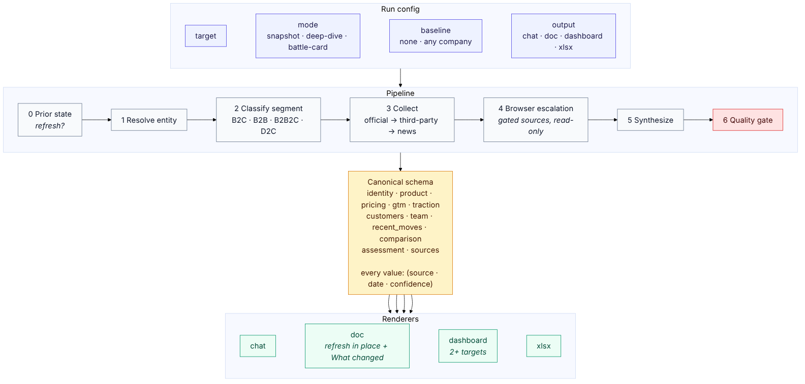
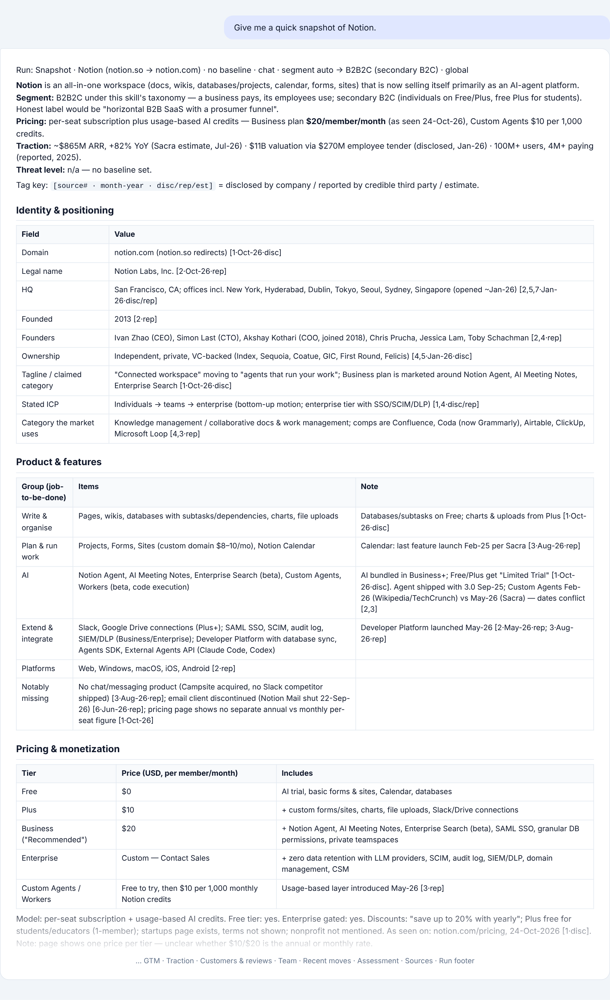
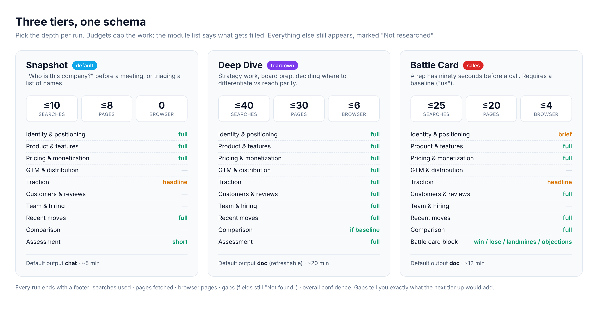

# claude-competitor-research

A Claude skill that turns "look into this company" into a repeatable research product: fixed inputs, three depth tiers, a canonical data schema, and the same output layout every time, so two runs a month apart are directly comparable.

Works on any company or startup in **B2C, B2B, B2B2C or D2C**. Contains no company data of its own; every fact is pulled live from the web at run time, with source, date and confidence attached.



## What you get

Ask Claude something like:

> Give me a quick snapshot of Notion.
> Deep dive on Zepto, India focus.
> Build a battle card for Notion vs Coda. We sell Coda.
> Refresh the Figma competitor doc.

and the skill resolves a run config, works through a fixed pipeline, and renders the result in the surface that fits the mode.



*Top of a real Snapshot run (full file in [`examples/notion-snapshot.md`](examples/notion-snapshot.md)).*

## Three tiers



| Mode | Use it when | Default output |
|---|---|---|
| **Snapshot** | You need to know who a company is in five minutes | chat |
| **Deep Dive** | Strategy, board prep, deciding where to differentiate vs reach parity | refreshable doc |
| **Battle Card** | A salesperson needs win/lose/landmines/objections before a call; requires a baseline ("us") | doc |

`xlsx` can be added to any run. `dashboard` is reserved for landscapes of two or more targets.

## Why it behaves like a product, not a prompt

- **Run config, not vibes.** `target · mode · baseline · output · segment · region`, inferred from your message and echoed back in one line before any search starts. It only asks when a field is both unknown and material (two companies share a name; Battle Card without a baseline).
- **Budgets.** Each tier caps searches, pages fetched and browser pages, so a casual lookup stays cheap and a teardown stays thorough. The run footer reports what was actually spent.
- **Canonical schema.** Everything passes through one YAML shape (`identity · product · pricing · gtm · traction · customers · team · recent_moves · comparison · assessment · sources`). Renderers read from it; nothing is written straight to a doc or sheet.
- **Evidence rules.** Every number carries `(source · date · confidence)` where confidence is `disclosed`, `reported`, `estimate`, `calc` or `internal`. Empty fields stay `Not found` rather than being reasoned into a number. Estimates are rendered as bands. Contradictions between sources are shown, not silently resolved.
- **Refresh, not rewrite.** If a `Competitor: <target>` doc already exists, the run updates it in place and writes a "What changed since" block at the top. This is the point of the skill for anyone tracking more than one competitor.
- **Segment-aware.** B2C, B2B, B2B2C and D2C each have their own source playbook and metrics that matter (take rate and breakage for B2B2C, SKU range and discount depth for D2C, seat price and free-to-paid for B2B).
- **Stable layout.** Section order never changes between runs or companies. A module that was out of scope still appears, marked "Not researched in Snapshot", so a reader knows it was looked for.

## Install

### Claude Code

Personal (all projects on this machine):

```bash
git clone https://github.com/<you>/claude-competitor-research.git
mkdir -p ~/.claude/skills
cp -r claude-competitor-research/competitor-research ~/.claude/skills/
```

Project (committed, so teammates get it):

```bash
cp -r claude-competitor-research/competitor-research .claude/skills/
```

Then invoke with `/competitor-research` or just ask in plain words; Claude loads it automatically when the request matches.

### Claude app (web / desktop / Cowork)

1. Zip the skill folder so that `competitor-research/` is at the root of the archive:
   ```bash
   cd claude-competitor-research && zip -r competitor-research.zip competitor-research
   ```
2. In the Claude app go to **Customize → Skills**, upload the zip, and switch the skill on.

The frontmatter `description` is kept under the app's 200-character limit on purpose; do not lengthen it if you fork.

### Requirements

Web search and web fetch must be enabled. Deep Dive and Battle Card can additionally use a browser tool for gated pages (LinkedIn, G2, Crunchbase, Similarweb) when one is available; without it those fields are marked `Not found (gated)` and the run continues.

## Examples

Both were produced by the skill on 2026-10-24 with no manual editing. Figures are as found that day.

| File | Mode | Notes |
|---|---|---|
| [`examples/notion-snapshot.md`](examples/notion-snapshot.md) | Snapshot | 7 searches, 8 fetches, no browser. Shows the chat layout, the tag key, bands for headcount, and a dated conflict between two sources on a launch month. |
| [`examples/notion-vs-coda-battle-card.md`](examples/notion-vs-coda-battle-card.md) | Battle Card | 13 searches, 18 fetches. Baseline researched from public sources because no internal facts were supplied, and says so. Surfaced that Coda had been renamed mid-2026, which reshaped the card. |

## Repo layout

```
competitor-research/
  SKILL.md            the skill itself (single file, ~155 lines)
examples/
  notion-snapshot.md
  notion-vs-coda-battle-card.md
docs/images/
  pipeline.png  tiers.png  sample-output.png
```

## Customising

The skill is a method, not a dataset, so most forks only touch three things:

- **Tier budgets** (section 1 of `SKILL.md`). Raise the Snapshot fetch cap if your runs keep ending with gaps you care about.
- **Source playbook** (section 3). Add the review sites, registries or news outlets that matter in your market. The Indian-market notes in section 6 are the pattern to copy.
- **Renderers** (section 5). Change section order or add a surface. Keep the rule that every renderer reads from the schema.

If your baseline is always your own product, keep its internal facts (actual pricing, feature status, reference customers) in a project file and tell Claude to read it; the skill tags those `internal` and keeps them out of shareable dashboards.

## Known limits

- Search results frequently come back as titles and URLs without snippets, so page fetches, not searches, are the binding constraint. The budgets reflect that.
- JavaScript-rendered pricing pages return nothing to a plain fetch; a browser pass fixes this, otherwise the skill falls back to third-party captures and tags them `reported`.
- Headcount and traffic are estimates from directories and are always rendered as bands. If you need a point value, get it from the company.

## Licence

MIT. See [LICENSE](LICENSE).
